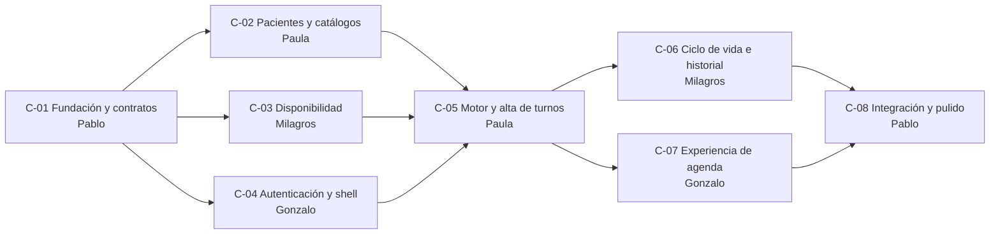

# CHANGES — Secuencia de Implementación

> Índice canónico de todos los changes del proyecto **Agenda odontológica para profesional independiente**.
> Cada change es atómico: un integrante puede implementarlo en una sesión aproximada de 4–6 horas.
> **Leer este archivo antes de empezar un item.**

---

## Cómo usar este documento

1. Identificar el item a implementar y verificar que sus dependencias estén completas.
2. Confirmar en el primer mensaje quién trabaja: `Soy <integrante> y trabajaré C-XX <slug>`.
3. Ejecutar el protocolo Git de este documento y comprobar que la rama activa sea la asignada antes de modificar archivos.
4. Leer los documentos de la Knowledge Base indicados en “Leer antes” y respetar el ownership de carpetas.
5. Acordar mediante OpenSpec el alcance, las decisiones P1 aplicables y la verificación antes de implementar.
6. Implementar y verificar los criterios acordados con MariaDB real cuando la prueba dependa de persistencia o concurrencia.
7. Marcar `[x]` únicamente después de registrar la verificación técnica y una participación demostrable en commits.

Los IDs no se renumeran al editar el roadmap. `CHANGES.md` conserva alcance y dependencias; el seguimiento operativo es local. Las capacidades posteriores al MVP —mensajería, reserva pública, historia clínica, pagos, ARCA y obras sociales— no se incorporan en estos changes.

### Protocolo Git por change

Se usa una rama corta por change. No se usa una rama permanente por integrante y nadie implementa directamente sobre `main`.

| Change | Responsable | Rama obligatoria |
|---|---|---|
| C-01 | Pablo | `change/c-01-foundation-and-contracts` |
| C-02 | Paula | `change/c-02-patients-and-catalogs` |
| C-03 | Milagros | `change/c-03-availability-and-schedule-settings` |
| C-04 | Gonzalo | `change/c-04-authentication-and-app-shell` |
| C-05 | Paula | `change/c-05-appointment-creation-engine` |
| C-06 | Milagros | `change/c-06-appointment-lifecycle-history` |
| C-07 | Gonzalo | `change/c-07-agenda-experience` |
| C-08 | Pablo | `change/c-08-integration-ui-polish` |

Antes de trabajar, el responsable debe ejecutar y revisar:

```powershell
git status --short --branch
git fetch origin
git switch main
git pull --ff-only origin main
git switch -c change/c-XX-slug-exacto
git branch --show-current
```

El último `switch -c` se usa solamente para crear una rama nueva. Si la rama ya existe localmente, se usa `git switch change/c-XX-slug-exacto`; si existe únicamente en remoto, se usa `git switch --track origin/change/c-XX-slug-exacto`. Sustituir siempre el ejemplo por el nombre exacto de la tabla.

Si `git status` muestra trabajo local, si `pull --ff-only` falla o si la rama ya existe en un estado inesperado, el agente debe detenerse y avisar: no puede usar `stash`, borrar archivos, forzar el cambio de rama ni resolverlo por su cuenta. Cambiar de rama está autorizado como preparación del trabajo; `commit`, `push` y `merge` siguen requiriendo pedido explícito. Pablo integra en `main` después de revisar cada change.

Orden de creación desde `main`: C-01 parte de la fundación inicial; C-02, C-03 y C-04 se crean después de integrar C-01; C-05 después de integrar C-02, C-03 y C-04; C-06 y C-07 después de integrar C-05; C-08 después de integrar C-06 y C-07.

### Ownership de directorios y archivos compartidos

Cada change puede crear o modificar únicamente sus **directorios propios** y los archivos enumerados como **compartidos permitidos** en su ficha. El ownership incluye código, tests y contratos específicos ubicados dentro de esos paths.

C-01 debe dejar preparados los puntos de composición globales antes del primer fork: módulos NestJS importables por dominio, rutas React componibles por feature y configuración de tests. Así, C-02, C-03 y C-04 no necesitan editar simultáneamente `backend/src/app.module.ts`, `frontend/src/app/` ni los archivos de configuración raíz.

Reglas transversales:

- `openspec/changes/<slug-del-change>/**` pertenece exclusivamente al responsable de ese change.
- `backend/src/database/migrations/**` es compartido **solo para agregar archivos nuevos**. El nombre debe incluir `CXX`; nunca se modifica una migración ya integrada.
- `backend/package.json`, `frontend/package.json` y sus lockfiles son compartidos controlados. C-01 instala la base común; una dependencia posterior requiere justificación y coordinación previa.
- `backend/src/app.module.ts`, `backend/src/main.ts`, `frontend/src/main.tsx`, `frontend/src/app/**`, `frontend/src/shared/**`, `backend/src/shared/**`, `AGENTS.md`, `CHANGES.md`, `knowledge-base/**` y `design-system/**` no se editan desde branches paralelos salvo los subpaths asignados expresamente en una ficha o un permiso explícito registrado.
- Los contratos específicos viven con su dominio. Un cambio de contrato consumido por otro owner se propone primero; no se edita al consumidor ajeno en el mismo branch.
- El roadmap fija carpetas; cada proposal/design de OpenSpec debe reducirlas a una lista de archivos previstos antes de Apply. Esa lista puede ser más pequeña, nunca más amplia sin aprobación.
- Una necesidad fuera de los paths declarados detiene el Apply: el responsable informa archivo, motivo e impacto; Pablo aprueba la excepción o la reserva para C-08.

| Change | Superficie principal exclusiva |
|---|---|
| C-01 | raíz técnica, configuración, shared y puntos de composición |
| C-02 | `patients` y `catalogs` en backend/frontend |
| C-03 | `availability` en backend/frontend |
| C-04 | `auth` y `app/shell` en backend/frontend |
| C-05 | núcleo y creación de `appointments` |
| C-06 | lifecycle e historial de `appointments` |
| C-07 | consultas y experiencia de `agenda` |
| C-08 | integración final sobre superficies ya fusionadas |

### Protocolo OpenSpec en branches

OpenSpec comparte un root, pero cada propuesta activa debe usar un directorio exclusivo cuyo nombre comience con el ID del roadmap:

```text
openspec/changes/c-02-patients-and-catalogs/
openspec/changes/c-03-availability-and-schedule-settings/
openspec/changes/c-04-authentication-and-app-shell/
```

Los integrantes usan `active-delivery` → `openspec-propose` → aprobación → `openspec-apply-change` → verificación dentro de su branch. No vuelven a ejecutar la fundación ni `openspec init` porque el root, la KB, el roadmap, el registro y las instrucciones ya son compartidos.

`openspec-sync-specs` y `openspec-archive-change` quedan reservados para Pablo después de integrar el branch en `main`. De este modo, los branches paralelos no modifican `openspec/specs/**` ni `openspec/changes/archive/**` y sus artefactos de planificación permanecen aislados por nombre.

C-01 debe implementar un guard de pull requests en `.github/workflows/change-scope.yml` más un verificador versionado en `scripts/change-scope/**`. El guard toma el nombre `change/c-XX-<slug>`, calcula el diff contra la rama base y rechaza paths no autorizados por el mapa de ownership. También rechaza en branches paralelos cambios en archivos globales protegidos, `openspec/specs/**`, `openspec/changes/archive/**` y `.active-orchestrator-state.json`.

---

## Árbol de dependencias

```text
C-01 foundation-and-contracts                         [Pablo]
  │
  ├── C-02 patients-and-catalogs                      [Paula]
  ├── C-03 availability-and-schedule-settings         [Milagros]
  └── C-04 authentication-and-app-shell               [Gonzalo]
        │
        └── C-05 appointment-creation-engine          [Paula] ← también requiere C-02 + C-03
              │
              ├── C-06 appointment-lifecycle-history [Milagros]
              └── C-07 agenda-experience             [Gonzalo]
                    │
                    └── C-08 integration-ui-polish    [Pablo] ← también requiere C-06
```



### Paralelismo por fase

> Cada gate es un punto de sincronización. Los changes dentro del mismo gate pueden avanzar en ramas separadas.

```text
GATE 0: ninguna
  → C-01 foundation-and-contracts                 [Pablo]

GATE 1: C-01 ✓                                   ← PRIMER FORK (3 paralelos)
  → C-02 patients-and-catalogs                    [Paula]
  → C-03 availability-and-schedule-settings       [Milagros]
  → C-04 authentication-and-app-shell             [Gonzalo]

GATE 2: C-02 + C-03 + C-04 ✓
  → C-05 appointment-creation-engine              [Paula]

GATE 3: C-05 ✓                                   ← SEGUNDO FORK (2 paralelos)
  → C-06 appointment-lifecycle-history            [Milagros]
  → C-07 agenda-experience                        [Gonzalo]

GATE 4: C-06 + C-07 ✓
  → C-08 integration-ui-polish                    [Pablo]
```

### Camino crítico (6 changes — mínimo irreducible)

```text
C-01 → C-03 → C-05 → C-06* → C-08
                   └→ C-07* ┘
```

`C-06` y `C-07` son finales paralelos igualmente indispensables antes del cierre; cualquiera de los dos puede determinar la duración real del camino crítico.

### Plan óptimo con 4 integrantes

| Paso | Pablo — Fundación/Integración | Paula — Dominio core | Milagros — Agenda auxiliar | Gonzalo — Acceso/Frontend |
|---:|---|---|---|---|
| 1 | C-01 foundation-and-contracts | — | — | — |
| 2 | Soporte de contratos, sin invadir ownership | C-02 patients-and-catalogs | C-03 availability-and-schedule-settings | C-04 authentication-and-app-shell |
| 3 | Revisión de integración | C-05 appointment-creation-engine | Tests de contrato de disponibilidad | Preparación de agenda contra contratos congelados |
| 4 | Preparación del cierre | Verificación de concurrencia de C-05 | C-06 appointment-lifecycle-history | C-07 agenda-experience |
| 5 | C-08 integration-ui-polish | Correcciones propias de C-02/C-05 | Correcciones propias de C-03/C-06 | Correcciones propias de C-04/C-07 |

La asignación deja dos changes con ownership principal para cada integrante. Pablo realiza el primer y último change, como se acordó; Paula, Milagros y Gonzalo reciben dos unidades funcionales trazables y de peso comparable.

---

## FASE 0 — Contratos y fundación técnica

### [C-01] `foundation-and-contracts`
- **Estado**: `[ ]` pendiente
- **Directorios propios**:
  - raíz técnica: `.gitignore`, `README.md`, `.env.example` y configuración de workspace que se apruebe en el design;
  - `.github/workflows/change-scope.yml` y `scripts/change-scope/**` para validar el ownership de cada pull request;
  - `backend/**` y `frontend/**` únicamente durante la fundación inicial;
  - `backend/src/config/**`, `backend/src/database/**`, `backend/src/shared/**`;
  - `frontend/src/app/**`, `frontend/src/shared/**` y puntos de composición/rutas vacíos por feature;
  - `design-system/**` para integración del sistema ya aprobado, sin redefinirlo.
- **Compartidos permitidos**: todos los archivos técnicos iniciales, porque todavía no existe el fork. Después de integrar C-01, pasan a regir los owners de C-02 a C-08.
- **Scope**:
  - Resolver en el proposal/design las decisiones P1-05 y P1-06: ORM/migraciones, estrategia de concurrencia, mecanismo de sesión y bootstrap de la primera cuenta.
  - Crear `backend/` con NestJS + TypeScript, healthcheck `/api/health`, configuración validada y conexión MariaDB; crear `frontend/` con React + TypeScript.
  - Fijar versiones en lockfiles, scripts reproducibles, `.env.example` sin secretos y comandos de desarrollo/test documentados.
  - Crear contratos compartidos de API y errores para pacientes, catálogos, disponibilidad, autenticación, turnos e historial sin implementar todavía sus reglas.
  - Implementar el guard de scope de pull requests con una matriz versionada de branch → paths permitidos; probar casos permitido y rechazado sin depender de servicios externos pagos.
  - Integrar los tokens y contratos de `design-system/` sin copiar la marca provisional dentro del dominio.
  - Definir ownership: `patients/catalogs` Paula, `availability` Milagros, `auth/app-shell/agenda` Gonzalo, integración raíz Pablo.
  - Tests: arranque backend/frontend, healthcheck, conexión de integración con MariaDB y validación de configuración faltante.
- **Dependencias**: ninguna
- **Governance**: ALTO
- **Leer antes**:
  - `knowledge-base/01_vision_y_objetivos.md` §Restricciones de entrega
  - `knowledge-base/02_descripcion_general.md` §Stack tecnológico
  - `knowledge-base/08_arquitectura_propuesta.md` §Estructura de directorios propuesta
  - `knowledge-base/09_decisiones_y_supuestos.md` §DD-09 — Stack tecnológico
  - `knowledge-base/10_preguntas_abiertas.md` §Preguntas abiertas priorizadas

---

## FASE 1 — Ramas independientes del MVP

> Al cerrar C-01, C-02, C-03 y C-04 se desarrollan en paralelo. Ninguna rama debe modificar carpetas asignadas a otra sin coordinar primero el contrato.

### [C-02] `patients-and-catalogs`
- **Estado**: `[ ]` pendiente
- **Directorios propios**:
  - `backend/src/modules/patients/**`;
  - `backend/src/modules/catalogs/**` — prestaciones y sillones;
  - `frontend/src/features/patients/**`;
  - `frontend/src/features/catalog/**`.
- **Compartidos permitidos**:
  - agregar migraciones nuevas identificadas con `C02` en `backend/src/database/migrations/**`;
  - su propio `openspec/changes/patients-and-catalogs/**` o slug final determinado por OpenSpec.
- **Scope**:
  - Resolver P1-01 para bajas lógicas e integridad histórica de pacientes, prestaciones y sillones.
  - Modelos y migraciones: `Paciente`, `Prestacion` y `Sillon`, con DNI único cuando no es nulo y referencias preservables para turnos históricos.
  - API REST: CRUD/búsqueda de `/api/pacientes`, `/api/prestaciones` y `/api/sillones`; paginación y errores de dominio consistentes.
  - Validar nombre/teléfono obligatorios, email opcional, duración `1..240` e intervalo opcional `0..30`; advertir nombre+teléfono repetidos sin bloquear.
  - Frontend por feature para listar, crear y editar las tres entidades usando tarjetas `rounded-2xl`, inputs moderados y modales del contrato aprobado.
  - Tests: DNI condicionalmente único, advertencia de duplicado, límites de duración/intervalo, referencias inactivas y fixtures totalmente ficticios.
- **Dependencias**: C-01
- **Governance**: MEDIO
- **Leer antes**:
  - `knowledge-base/04_modelo_de_datos.md` §Paciente, §Prestacion y §Sillon
  - `knowledge-base/05_reglas_de_negocio.md` §Dominio: pacientes y §Dominio: prestaciones e intervalos
  - `knowledge-base/06_funcionalidades.md` §Épica 1 y §Épica 2
  - `knowledge-base/07_flujos_principales.md` §Flujo 1: registrar paciente
  - `knowledge-base/10_preguntas_abiertas.md` §P1-01

---

### [C-03] `availability-and-schedule-settings`
- **Estado**: `[ ]` pendiente
- **Directorios propios**:
  - `backend/src/modules/availability/**`;
  - `frontend/src/features/availability/**`.
- **Compartidos permitidos**:
  - agregar migraciones nuevas identificadas con `C03` en `backend/src/database/migrations/**`;
  - su propio directorio de change OpenSpec.
- **Scope**:
  - Resolver P1-03: excepciones solo bloqueantes o también habilitaciones extraordinarias; documentar la decisión antes de Apply.
  - Modelos y migraciones: `ConfiguracionAgenda`, `DisponibilidadSemanal` y `ExcepcionDisponibilidad` con zona `America/Argentina/Buenos_Aires` e intervalo global inicial de 10 minutos.
  - API REST para configuración global, tramos semanales y excepciones fechadas de día completo o parciales.
  - Rechazar tramos invertidos/solapados y valores globales fuera de `0..30`; interpretar fechas recurrentes en calendario local.
  - Frontend por feature para editar horarios semanales, feriados, vacaciones y bloqueos con feedback explícito.
  - Tests: múltiples tramos por día, contigüidad, solapamiento, excepción total/parcial y conversiones local/UTC deterministas.
- **Dependencias**: C-01
- **Governance**: MEDIO
- **Leer antes**:
  - `knowledge-base/04_modelo_de_datos.md` §ConfiguracionAgenda, §DisponibilidadSemanal y §ExcepcionDisponibilidad
  - `knowledge-base/05_reglas_de_negocio.md` §Dominio: disponibilidad y §Dominio: tiempo
  - `knowledge-base/06_funcionalidades.md` §Épica 3: Disponibilidad
  - `knowledge-base/08_arquitectura_propuesta.md` §Diseño del motor temporal
  - `knowledge-base/10_preguntas_abiertas.md` §P1-03

---

### [C-04] `authentication-and-app-shell`
- **Estado**: `[ ]` pendiente
- **Directorios propios**:
  - `backend/src/modules/auth/**`;
  - `frontend/src/features/auth/**`;
  - `frontend/src/app/shell/**` y `frontend/src/app/routes/auth.routes.tsx`, preparados como puntos exclusivos por C-01.
- **Compartidos permitidos**:
  - agregar migraciones nuevas identificadas con `C04` en `backend/src/database/migrations/**`;
  - `backend/package.json`, `frontend/package.json` y lockfiles solo para dependencias de seguridad aprobadas en el design;
  - su propio directorio de change OpenSpec.
- **Scope**:
  - Implementar la decisión de sesión/token y bootstrap aprobada en C-01, sin registro público ni recuperación de contraseña en el MVP.
  - Modelo/migración de usuario único con email normalizado y hash de contraseña; nunca devolver ni registrar credenciales.
  - API: login, sesión vigente y logout según el mecanismo elegido; mensaje genérico para acceso inválido y protección de recursos.
  - Frontend: pantalla de acceso, guard de navegación y app shell responsive con navegación hacia Agenda, Pacientes y Configuración.
  - Usar el design system aprobado: azul `#0D3D9E`, verde `#73FFA0`, botones píldora e inputs no píldora.
  - Tests: acceso válido/inválido indistinguible por email, contraseña sin texto plano, expiración/logout y rutas protegidas.
- **Dependencias**: C-01
- **Governance**: CRITICO
- **Leer antes**:
  - `knowledge-base/03_actores_y_roles.md` §Roles del MVP
  - `knowledge-base/05_reglas_de_negocio.md` §Dominio: autenticación
  - `knowledge-base/06_funcionalidades.md` §Épica 7: Acceso mínimo
  - `knowledge-base/08_arquitectura_propuesta.md` §Seguridad
  - `knowledge-base/09_decisiones_y_supuestos.md` §DD-13 — Autenticación mínima

---

## FASE 2 — Núcleo temporal de turnos

### [C-05] `appointment-creation-engine`
- **Estado**: `[ ]` pendiente
- **Directorios propios**:
  - `backend/src/modules/appointments/core/**`;
  - `backend/src/modules/appointments/creation/**`;
  - `frontend/src/features/appointments/create/**`.
- **Compartidos permitidos**:
  - agregar migraciones nuevas identificadas con `C05` en `backend/src/database/migrations/**`;
  - su propio directorio de change OpenSpec.
- **Scope**:
  - Modelos y migraciones: `Turno` y evento inicial `CREADO`/`EXCEPCION`, conservando duración e intervalo efectivos.
  - Política pura para precedencia global/prestación/turno, intervalo semiabierto `[inicio, finBloqueo)` y estados bloqueantes aprobados.
  - API: crear turno ordinario o fuera de disponibilidad con motivo; rechazar conflictos globales del odontólogo y del sillón.
  - Ejecutar validación y persistencia de turno+evento en una operación atómica con la estrategia MariaDB aprobada en C-01.
  - Frontend por feature para alta de turno, selección de paciente/prestación/sillón, sobrescrituras y modal de excepción justificada.
  - Tests unitarios e integración: contigüidad válida, solapamientos entre sillones, precedencias, límites, override sin bypass de conflicto y dos altas concurrentes incompatibles.
- **Dependencias**: C-02, C-03, C-04
- **Governance**: MEDIO
- **Leer antes**:
  - `knowledge-base/04_modelo_de_datos.md` §Turno y §Restricciones temporales
  - `knowledge-base/05_reglas_de_negocio.md` §Dominio: turnos y solapamientos
  - `knowledge-base/06_funcionalidades.md` §US-030 y §US-031
  - `knowledge-base/07_flujos_principales.md` §Flujo 2 y §Flujo 3
  - `knowledge-base/08_arquitectura_propuesta.md` §Consistencia y concurrencia

---

## FASE 3 — Operación diaria paralela

> C-06 y C-07 pueden abrirse en paralelo cuando C-05 quede verificado. C-06 es dueño del lifecycle/historial; C-07 es dueño de la lectura y presentación de agenda.

### [C-06] `appointment-lifecycle-history`
- **Estado**: `[ ]` pendiente
- **Directorios propios**:
  - `backend/src/modules/appointments/lifecycle/**`;
  - `backend/src/modules/appointments/history/**`;
  - `frontend/src/features/appointments/lifecycle/**`.
- **Compartidos permitidos**:
  - agregar migraciones nuevas identificadas con `C06` en `backend/src/database/migrations/**`;
  - su propio directorio de change OpenSpec.
- **Scope**:
  - Resolver P1-02 y P1-04: campos visibles del historial y obligatoriedad de motivo al reprogramar.
  - Completar `EventoTurno` para `REPROGRAMADO`, `CANCELADO` y `CAMBIO_ESTADO`, inmutable desde la interfaz ordinaria.
  - API: reprogramar, cancelar, confirmar, atender, marcar ausencia y consultar historial cronológico.
  - Aplicar la matriz de transiciones, terminalidad, horario mínimo para ATENDIDO/AUSENTE y retorno a PROGRAMADO al reprogramar un confirmado.
  - Frontend aislado en `appointment-lifecycle/`: modales de reprogramación/cancelación, acciones de estado y timeline de historial.
  - Tests: transición por cada arista permitida, rechazo de aristas inválidas, motivo obligatorio, rollback ante conflicto y conservación de valores anteriores.
- **Dependencias**: C-05
- **Governance**: CRITICO
- **Leer antes**:
  - `knowledge-base/04_modelo_de_datos.md` §EventoTurno
  - `knowledge-base/05_reglas_de_negocio.md` §Matriz de transiciones y §Dominio: historial y auditoría
  - `knowledge-base/06_funcionalidades.md` §Épica 5: Ciclo de vida e historial
  - `knowledge-base/07_flujos_principales.md` §Flujos 4, 5 y 7
  - `knowledge-base/10_preguntas_abiertas.md` §P1-02 y §P1-04

---

### [C-07] `agenda-experience`
- **Estado**: `[ ]` pendiente
- **Directorios propios**:
  - `backend/src/modules/appointments/agenda/**`;
  - `frontend/src/features/agenda/**`.
- **Compartidos permitidos**:
  - su propio directorio de change OpenSpec;
  - ningún archivo de lifecycle de C-06: consume sus contratos sin editarlos.
- **Scope**:
  - Resolver P2-02 y fijar el rango máximo consultable sin introducir paginación temporal improvisada.
  - API de lectura de agenda por rango, sillón y estado, ordenada por inicio y con atención, intervalo, bloqueo y excepción diferenciados.
  - Frontend aislado en `agenda/`: vista diaria responsive, filtros, detalle de turno y refresco explícito sin calcular disponibilidad autoritativa en navegador.
  - Representar estados con texto+color+forma; mostrar intervalo y excepción sin exponer información clínica.
  - Reservar puntos de integración para las acciones de C-06 mediante contratos compartidos, sin editar sus componentes de lifecycle; C-08 realiza el ensamble final.
  - Tests: orden/filtros/rango inválido, render de estados, agenda vacía, error/refresco y responsive manual de escritorio/móvil sin Playwright.
- **Dependencias**: C-03, C-04, C-05
- **Governance**: MEDIO
- **Leer antes**:
  - `knowledge-base/05_reglas_de_negocio.md` §Dominio: turnos y solapamientos
  - `knowledge-base/06_funcionalidades.md` §US-032 — Consultar agenda
  - `knowledge-base/07_flujos_principales.md` §Flujo 6: consultar agenda
  - `knowledge-base/08_arquitectura_propuesta.md` §Estructura de directorios propuesta
  - `knowledge-base/10_preguntas_abiertas.md` §P2-02

---

## FASE 4 — Integración, calidad y entrega

### [C-08] `integration-ui-polish`
- **Estado**: `[ ]` pendiente
- **Directorios propios**:
  - `backend/test/integration/**` y `frontend/src/app/**` para ensamble final;
  - `docs/demo/**` para guion y evidencia de entrega;
  - superficies de C-02 a C-07 ya fusionadas, únicamente para correcciones de integración y pulido trazables.
- **Compartidos permitidos**:
  - `README.md`, `.env.example`, manifests/lockfiles, configuración raíz, `backend/src/app.module.ts`, `frontend/src/main.tsx`, `frontend/src/shared/**` y `design-system/**`; cualquier cambio al design system incrementa su revisión y requiere la aprobación prevista por su policy;
  - su propio directorio de change OpenSpec.
- **Scope**:
  - Integrar las ramas sin mover ownership: resolver incompatibilidades en contratos compartidos mediante cambios pequeños y trazables.
  - Aplicar el design system revisión 1 a toda la aplicación: radios acordados, paleta, modales, foco, estados vacíos/error/carga y reducción de movimiento.
  - Verificar el recorrido completo: login → paciente/catálogos → disponibilidad → alta → agenda → reprogramación/cancelación/estado → historial.
  - Ejecutar suites unitarias, integración MariaDB, API y build de frontend/backend; registrar qué fue automático y qué quedó como comprobación manual.
  - Completar README de instalación/ejecución, `.env.example`, seeds ficticios y guion de demostración del trabajo de los cuatro integrantes.
  - Auditar que no existan datos reales, secretos, integraciones fuera de alcance ni funcionalidades encubiertas.
- **Dependencias**: C-02, C-03, C-04, C-05, C-06, C-07
- **Governance**: MEDIO
- **Leer antes**:
  - `knowledge-base/01_vision_y_objetivos.md` §Métricas de éxito del MVP
  - `knowledge-base/07_flujos_principales.md`
  - `knowledge-base/08_arquitectura_propuesta.md` §Estrategia de pruebas
  - `knowledge-base/09_decisiones_y_supuestos.md` §DD-11 — Organización del equipo
  - `knowledge-base/10_preguntas_abiertas.md`

### Resumen operativo

| ID | Owner principal | Governance | Dependencias |
|---|---|---|---|
| C-01 | Pablo | ALTO | — |
| C-02 | Paula | MEDIO | C-01 |
| C-03 | Milagros | MEDIO | C-01 |
| C-04 | Gonzalo | CRITICO | C-01 |
| C-05 | Paula | MEDIO | C-02, C-03, C-04 |
| C-06 | Milagros | CRITICO | C-05 |
| C-07 | Gonzalo | MEDIO | C-03, C-04, C-05 |
| C-08 | Pablo | MEDIO | C-02…C-07 |

Primer item elegible: `C-01 foundation-and-contracts`. Por governance ALTO y por contener decisiones técnicas P1, debe pasar por proposal/design antes de modificar el proyecto.
