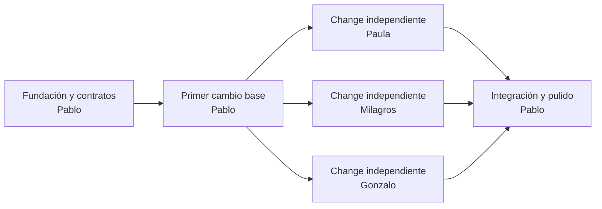

# Informe de Discovery — Sistema de turnos odontológicos

**Proyecto:** aplicación web para la gestión de turnos de un odontólogo independiente  
**Fecha de investigación:** 22 de noviembre de 2026  
**Fecha de entrega prevista:** 26 de noviembre de 2026  
**Equipo:** Pablo, Paula, Milagros y Gonzalo  
**Estado:** Discovery aprobado; verificación personal de cinco fuentes completada  
**Fuente rectora:** `consigna_global.pdf`

> Este informe documenta el Discovery solicitado por la consigna. Las funciones y precios corresponden a información pública de los proveedores consultada el 22/11/2026; no implican validación práctica. Cuando una capacidad no aparece en la evidencia revisada se informa como **No evidenciado**. No se utilizarán datos reales de pacientes.

## Resumen ejecutivo

Se analizaron quince sistemas odontológicos de Argentina, Latinoamérica y mercados internacionales. El mercado confirma que agenda, pacientes, historia clínica, odontograma, caja y recordatorios son capacidades habituales. En Argentina se vuelven especialmente relevantes WhatsApp, Mercado Pago, ARCA y obras sociales.

Para llegar a una entrega estable en cuatro días, se recomienda un MVP deliberadamente más pequeño: pacientes, prestaciones, sillones, disponibilidad y turnos sin solapamientos. El producto será usado inicialmente solo por un odontólogo independiente; no incluirá reserva pública ni integraciones reales. Su diferencial debe ser la corrección de las reglas temporales: duración configurable, intervalo obligatorio, excepciones justificadas e historial no destructivo.

La matriz ponderada ubica a DentalCore (4,45), Dentalink (4,40), DentalSoft (4,35), Dentrix Ascend (4,25) y Dentry (4,20) como las referencias generales mejor puntuadas según los criterios de la consigna. La verificación personal posterior introdujo un filtro cualitativo de confianza, actualidad y adecuación: para la demo se priorizan DentalCore, Dentry, Denteo, ZYRA y DrApp; se descartan DentalSoft, AgendaDental y Open Dental para este proyecto.

## Metodología y límites de evidencia

- Se revisaron sitios oficiales o páginas oficiales indexadas de quince productos.
- Cada solución tiene una nota normalizada en `docs/discovery/sources/` con URL, fecha, problema, usuarios, funciones, precio, posicionamiento, diferenciales y observaciones.
- La comparación usa una escala de 0 a 5. Un puntaje resume la evidencia pública encontrada; no equivale a una prueba del software.
- Los pesos son los indicados por la consigna: turnos y automatización 25%; clínica dental 20%; integraciones locales y WhatsApp 15%; administración 15%; experiencia del paciente 10%; seguridad, exportación y trazabilidad 10%; precio y adopción 5%.
- Fórmula: `total = Σ(puntaje × peso)`.
- Los datos comerciales pueden cambiar. Toda afirmación no respaldada por la evidencia consultada se marca **No evidenciado**.
- La consigna exige verificar personalmente al menos cinco fuentes. El equipo completó esa revisión el 22/11/2026 y sus conclusiones se documentan al final del informe.

## A. Relevamiento comparativo de sistemas

### A.1 Identidad, mercado y precio

| Sistema | Mercado / segmento | Modalidad | Precio público consultado | Fuente oficial |
|---|---|---|---|---|
| DentalCore | Argentina; profesionales y clínicas | Nube | ARS 75.000/mes, 2 usuarios | [dentalcore.app](https://dentalcore.app/software-dental/argentina) |
| Dentry | Argentina; independientes y consultorios | Nube | Gratis limitado; Basic ARS 29.999; Pro ARS 49.999/mes | [dentry.com.ar](https://www.dentry.com.ar/) |
| DentalSoft | Argentina; consultorios y clínicas | Nube | No se observaron planes durante la verificación personal | [dentalsoft.com.ar](https://www.dentalsoft.com.ar/) |
| DrApp | Argentina; salud multiespecialidad con módulo dental | Nube | Desde ARS 33.999 por agenda/mes + IVA | [drapp.com.ar](https://www.drapp.com.ar/odontologia) |
| ZYRA | Argentina; independientes y clínicas | Nube | ARS 15.000 / 29.000 / 39.000 por mes | [appzyra.ar](https://appzyra.ar/) |
| Denteo | Argentina; consultorios, clínicas y laboratorios | Nube y escritorio | Nube desde ARS 30.000/mes; escritorio ARS 230.000/año | [denteo.com.ar](https://denteo.com.ar/index.html) |
| NacarOS | Latinoamérica; clínicas pequeñas y medianas | PWA / nube | Gratis limitado; Pro USD 14,99/mes | [nacaros.com](https://www.nacaros.com/) |
| MISE Turnos | Argentina; agenda y reserva online | Nube | ARS 29.990 + IVA/mes por consultorio | [mise.ar](https://mise.ar/turnos-online/odontologos/) |
| Dentalink | Latinoamérica; independientes, clínicas y redes | Nube | Planes por cotización; módulo IA promocionado a USD 50/mes | [softwaredentalink.com](https://www.softwaredentalink.com/) |
| AgendaDental | México; consultorios y clínicas | Nube | MXN 550/mes hasta 4 sillones | [agendadental.mx](https://agendadental.mx/) |
| Simples Dental | Brasil; consultorios y redes | Nube | No publicado / página inaccesible durante la consulta | [simplesdental.com](https://www.waf.simplesdental.com/planos-e-precos) |
| Clinicorp | Brasil; clínicas, redes y franquicias | Nube | Standard R$ 149,90; Premium R$ 369,90/mes | [clinicorp.com](https://www.clinicorp.com/) |
| Open Dental | Principalmente EE. UU.; consultorios y clínicas | Escritorio/servicios conectados | USD 199/mes por ubicación, condiciones publicadas | [opendental.com](https://opendental.com/site/order.html) |
| Dentrix Ascend | EE. UU.; clínicas y multiubicación | Nube | Starter USD 199/mes | [dentrixascend.com](https://www.dentrixascend.com/) |
| CareStack | Mercado anglosajón; clínicas y organizaciones | Nube | No publicado | [carestack.com](https://carestack.com/) |

### A.2 Comparación funcional basada en evidencia pública

Leyenda: **Sí** = evidenciado en la fuente consultada; **Parcial** = existe una capacidad relacionada, pero no se comprobó el alcance completo; **No evidenciado** = no se encontró respaldo suficiente.

| Sistema | Agenda / automatización | Clínica dental | WhatsApp / comunicación | Administración | Adecuación argentina |
|---|---|---|---|---|---|
| DentalCore | Sí | Sí | Sí | Caja, señas, facturación | ARCA, obras sociales, Mercado Pago |
| Dentry | Sí | Sí | Sí | Presupuestos y cuenta corriente | ARCA, obras sociales y normativa local |
| DentalSoft | Sí | Sí | Sí | Caja, deudas y liquidaciones | Mercado Pago y obras sociales; ARCA no evidenciado |
| DrApp | Sí | Sí | Sí | Cobros, facturación y API | ARCA y Mercado Pago |
| ZYRA | Sí | Sí | Sí | Caja, stock y liquidaciones | ARCA en Premium y obras sociales |
| Denteo | Sí | Sí | Plantillas WhatsApp | Facturación y laboratorio | ARCA y compatibilidad declarada con Mercado Pago |
| NacarOS | Sí | Sí | Asistente WhatsApp con IA | Caja y presupuestos | ARCA, obras sociales y Mercado Pago no evidenciados |
| MISE Turnos | Sí | No evidenciado | Sí | Señas e historial de turnos | Mercado Pago y obras sociales declaradas al reservar |
| Dentalink | Sí | Sí | Sí | Caja, inventario y multisucursal | ARCA no evidenciado |
| AgendaDental | Sí, por sillón y doctor | Sí | Sí | Caja, honorarios y pagos | Adaptación fiscal mexicana; Argentina no evidenciado |
| Simples Dental | Sí | Sí | Sí | Finanzas y analítica | Integraciones argentinas no evidenciadas |
| Clinicorp | Sí | Sí | Sí | Finanzas, CRM y metas | Integraciones argentinas no evidenciadas |
| Open Dental | Sí | Sí | Email/texto; WhatsApp no evidenciado | Billing y portal | Integraciones argentinas no evidenciadas |
| Dentrix Ascend | Sí | Sí | Mensajería; WhatsApp no evidenciado | Seguros, pagos y analítica | Integraciones argentinas no evidenciadas |
| CareStack | Sí | Sí | Comunicación integrada; WhatsApp no evidenciado | Billing, nómina y analítica | Integraciones argentinas no evidenciadas |

### A.3 Observaciones de calidad de la evidencia

- DentalCore, Dentry, DrApp, ZYRA y Denteo muestran adecuación explícita al mercado argentino y conservaron interés luego de la revisión personal.
- DentalSoft presentaba capacidades atractivas en la investigación inicial, pero la revisión personal no encontró planes visibles y generó baja confianza en la presentación del sitio; se descarta como referencia práctica.
- AgendaDental pertenece al mercado mexicano y su página no cargó durante la revisión personal; se descarta por falta de adecuación y verificabilidad práctica.
- Open Dental fue considerado visual y operativamente anticuado para el objetivo del proyecto; se descarta como referencia de producto o interfaz.
- Para MISE Turnos y ZYRA, parte del contenido provino de páginas oficiales indexadas porque la apertura automatizada no devolvió contenido legible.
- La página oficial de precios de Simples Dental devolvió un error durante la consulta; por eso no se trasladaron precios de terceros.
- Las métricas de adopción o mejora publicadas por proveedores se consideran afirmaciones comerciales, no resultados independientes.
- No se comprobó en una demo la prevención de solapamientos de ninguno de los productos.

## B. Matriz de evaluación ponderada

La versión editable está en `docs/discovery/matriz-evaluacion.csv`.

| Pos. | Producto | Turnos 25% | Clínica 20% | Local/WA 15% | Admin. 15% | Paciente 10% | Seg./traz. 10% | Precio 5% | Total / 5 |
|---:|---|---:|---:|---:|---:|---:|---:|---:|---:|
| 1 | DentalCore | 4 | 5 | 5 | 5 | 4 | 4 | 3 | **4,45** |
| 2 | Dentalink | 5 | 5 | 3 | 5 | 5 | 4 | 1 | **4,40** |
| 3 | DentalSoft | 5 | 4 | 5 | 4 | 5 | 3 | 3 | **4,35** |
| 4 | Dentrix Ascend | 5 | 5 | 1 | 5 | 5 | 5 | 2 | **4,25** |
| 5 | Dentry | 4 | 4 | 5 | 4 | 3 | 5 | 5 | **4,20** |
| 6 | DrApp | 4 | 4 | 5 | 4 | 4 | 4 | 3 | **4,10** |
| 7 | Denteo | 4 | 4 | 5 | 4 | 3 | 4 | 4 | **4,05** |
| 7 | AgendaDental | 5 | 4 | 3 | 4 | 4 | 3 | 5 | **4,05** |
| 9 | CareStack | 5 | 4 | 1 | 5 | 5 | 5 | 0 | **3,95** |
| 10 | Clinicorp | 4 | 4 | 2 | 5 | 4 | 4 | 4 | **3,85** |
| 11 | ZYRA | 4 | 3 | 5 | 4 | 3 | 3 | 5 | **3,80** |
| 12 | NacarOS | 4 | 5 | 3 | 3 | 4 | 2 | 5 | **3,75** |
| 13 | Open Dental | 4 | 5 | 1 | 4 | 3 | 3 | 3 | **3,50** |
| 14 | Simples Dental | 4 | 4 | 2 | 4 | 4 | 3 | 1 | **3,45** |
| 15 | MISE Turnos | 5 | 1 | 4 | 2 | 5 | 2 | 4 | **3,25** |

### Interpretación

- **DentalCore** obtiene el mayor puntaje por combinar alcance dental, administración e integraciones argentinas.
- **Dentalink** y **Dentrix Ascend** puntúan alto por amplitud funcional, aunque pierden adecuación local o accesibilidad de precio.
- **DentalSoft** mantiene un puntaje alto por las capacidades publicadas, pero la evaluación cualitativa posterior aconseja descartarlo como referencia del proyecto.
- **Dentry** se destaca por precio de entrada, auditoría y contexto normativo local.
- La matriz orienta la comparación, pero no reemplaza la verificación personal ni una demo práctica.

## C. Análisis competitivo

### C.1 Funciones que ya son estándar

- Agenda diaria/semanal y estados de turno.
- Registro de pacientes e historia clínica.
- Odontograma y planes de tratamiento en sistemas dentales completos.
- Recordatorios y confirmaciones por canales digitales.
- Presupuestos, caja y seguimiento de deudas.
- Roles, permisos y exportación o respaldo de información.
- Acceso web o cloud desde varios dispositivos.

### C.2 Diferenciadores reales observados

- **Localización argentina:** ARCA, obras sociales, pesos y Mercado Pago.
- **Automatización de agenda:** reserva online, recordatorios, señas y recuperación de pacientes.
- **Trazabilidad clínica:** historia inalterable, auditoría de accesos y exportación.
- **Modelado de recursos:** agenda por sillón, profesional o sede.
- **Extensibilidad:** API, integraciones y módulos activables.
- **Operación híbrida u offline:** ediciones de escritorio o PWA con capacidades desconectadas declaradas.
- **IA aplicada:** dictado clínico, radiología, atención y generación de notas; su alcance real requiere verificación.

### C.3 Vacíos y oportunidades en Argentina

- La prevención de solapamientos entre odontólogo, sillón, duración e intervalo no suele explicarse públicamente con precisión.
- Las soluciones completas pueden ser excesivas para un profesional independiente que solo necesita una agenda confiable.
- Los precios, límites y costos variables de mensajería no siempre son transparentes.
- Existe una oportunidad de ofrecer reglas temporales claras, explicables y cubiertas por tests.
- La integración local puede incorporarse por etapas, sin obligar al MVP a resolver facturación, pagos e historia clínica simultáneamente.
- Un historial visible de excepciones, cancelaciones y reprogramaciones puede generar confianza sin introducir un módulo de auditoría empresarial.

### C.4 Oportunidades de innovación razonables

1. Explicar por qué un horario no está disponible: turno existente, intervalo, bloqueo o fuera de agenda.
2. Permitir excepciones justificadas sin ocultar que se violó la disponibilidad habitual.
3. Simular el impacto de cambiar la duración o el intervalo antes de guardar.
4. Preparar contratos de mensajería para WhatsApp y email sin acoplar el dominio a un proveedor.
5. Mantener una experiencia simple para una sola persona, evitando configuración propia de clínicas grandes.

## D. Recomendación de producto y MVP

### D.1 Cinco soluciones para demostración

1. **DentalCore:** referencia integral argentina; revisar ARCA, obras sociales, Mercado Pago y agenda.
2. **Dentry:** referencia de trazabilidad, acceso económico, adecuación legal argentina y una presentación visual clara.
3. **Denteo:** referencia de agenda visual, laboratorio y alternativa nube/escritorio.
4. **ZYRA:** referencia de precios locales publicados, roles y módulos por plan.
5. **DrApp:** referencia de modularidad, integraciones locales y evolución desde un consultorio individual.

La selección no replica exactamente los cinco primeros de la matriz: prioriza productos argentinos y accesibles para comparar el problema concreto del proyecto.

### D.2 Tres referencias de experiencia de usuario

1. **DentalCore:** componentes percibidos como confiables, claros e intuitivos durante la revisión personal.
2. **Dentry:** presentación visual cuidada y comunicación clara de las diferencias entre planes.
3. **Dentrix Ascend:** referencia internacional para claridad de dashboards y estados, sin trasladar sus integraciones estadounidenses.

### D.3 Alcance esencial del MVP

- Pacientes con nombre y teléfono obligatorios; DNI y email opcionales.
- Prestaciones con duración predeterminada, modificable al crear el turno.
- Sillones múltiples, aunque un único odontólogo impide turnos simultáneos.
- Intervalo global obligatorio, sobrescribible por prestación.
- Disponibilidad semanal recurrente y excepciones por fecha.
- Turnos en estados PROGRAMADO, CONFIRMADO, ATENDIDO, CANCELADO y AUSENTE.
- Creación y edición sin solapamientos del odontólogo ni del sillón.
- Reprogramación y cancelación con motivo e historial anterior.
- Excepción manual fuera de disponibilidad, siempre con motivo y auditoría.
- Tests automatizados de las reglas de duración, intervalo y solapamiento.

### D.4 Diferencial recomendado

La propuesta no debe competir por cantidad de módulos. Debe demostrar una agenda confiable y explicable: cálculo consistente de duración e intervalo, ausencia de simultaneidad para un único odontólogo, excepciones justificadas e historial no destructivo.

### D.5 Fuera del MVP, en orden sugerido

1. Recordatorios y confirmaciones por WhatsApp y correo electrónico.
2. Reserva pública de turnos.
3. Historia clínica, odontograma y consentimientos.
4. Caja, señas y Mercado Pago.
5. Facturación ARCA.
6. Obras sociales y prepagas.
7. Portal del paciente, informes e IA.

## Decisiones aprobadas de producto

### Usuarios y alcance

- Segmento principal: odontólogo independiente.
- Único usuario del MVP: el odontólogo; la recepcionista queda fuera.
- El paciente es una entidad administrada y no inicia sesión.
- No hay reserva pública ni integraciones reales en el MVP.

### Reglas de turnos

- La duración efectiva es la sobrescritura del turno o, en su ausencia, la duración predeterminada de la prestación.
- El intervalo efectivo es la sobrescritura de la prestación o, en su ausencia, el intervalo global.
- Un turno bloquea al odontólogo y al sillón por su duración efectiva más el intervalo efectivo.
- No se permiten turnos simultáneos aunque utilicen sillones distintos.
- Un turno fuera de disponibilidad solo puede guardarse como excepción manual con motivo.
- Los turnos cancelados no se eliminan; las reprogramaciones conservan fecha y hora anteriores.
- El DNI es único cuando está informado. Coincidir en nombre y teléfono genera una advertencia, no un bloqueo automático.

### Arquitectura y límites

- Backend: NestJS.
- Frontend: React.
- Base de datos: MariaDB.
- Se definirán límites para integrar luego WhatsApp, email, Mercado Pago, ARCA y obras sociales, sin implementar esas conexiones en el MVP.

## Restricciones, equipo y estrategia de entrega

El equipo de cuatro integrantes fue confirmado como autorizado para esta entrega, aunque la consigna general menciona grupos de hasta tres. Pablo realiza la fundación y el primer cambio transversal; Paula, Milagros y Gonzalo reciben cambios equivalentes e independientes; Pablo cierra con integración y pulido visual. La asignación definitiva corresponde al roadmap posterior, no a este Discovery.

Para evitar solapamientos, los contratos compartidos y reglas de calendario deben cerrarse antes de abrir las tres ramas paralelas. Cada change deberá declarar archivos propios, dependencias y criterios de aceptación. El pulido final no debe absorber funciones incompletas.

## Riesgos y mitigaciones

| Riesgo | Prob. | Impacto | Mitigación |
|---|---|---|---|
| Alcance excesivo | Alta | Alto | Congelar el MVP; pasar clínica, pagos e integraciones a etapas posteriores. |
| Regla de solapamiento incorrecta | Media | Alto | Definir intervalos con ejemplos de borde y tests unitarios/integra­ción. |
| Tests complejos o frágiles | Media | Alto | Reloj controlado, datos ficticios y casos deterministas. |
| Conflictos entre ramas | Media | Alto | Contratos base primero; ownership de archivos y tres changes independientes. |
| Datos comerciales desactualizados | Media | Medio | Mantener fecha/URL y completar verificación humana. |
| Datos personales reales en demos | Baja | Alto | Usar exclusivamente pacientes ficticios y revisar fixtures/capturas. |
| Pulido final demasiado grande | Media | Medio | Integración continua y criterios de aceptación por change. |

## Preguntas abiertas que deben resolverse antes o durante la KB

- Valor inicial y unidad del intervalo global.
- Límites mínimos y máximos para duraciones e intervalos.
- Política de baja lógica para pacientes, prestaciones y sillones.
- Zona horaria y formato de fecha/hora.
- Estados que liberan o mantienen ocupado un horario.
- Alcance mínimo de autenticación del odontólogo.
- Qué detalle del historial será visible desde la interfaz.

## Verificación personal obligatoria de fuentes

Estado general: **COMPLETADA EL 22/11/2026**. La revisión se utiliza como control cualitativo de la investigación y como criterio para seleccionar referencias; no requiere capturas ni una columna adicional de evidencia.

| # | Fuente revisada | Aspectos contrastados | Resultado de la revisión | Decisión |
|---:|---|---|---|---|
| 1 | [DentalCore Argentina](https://dentalcore.app/software-dental/argentina) | Precio, ARCA, obras sociales y Mercado Pago | Se confirmaron las funcionalidades revisadas. La propuesta se percibe confiable, intuitiva y con componentes adecuados como referencia visual. | **Priorizar** |
| 2 | [Dentry](https://www.dentry.com.ar/) | Límites del plan gratuito, precios y auditoría | La presentación se percibe cuidada. Gratis: hasta 50 pacientes y 100 turnos mensuales, agenda completa, historia clínica con odontograma, consentimiento digital y uso individual. Basic: ARS 30.000, sin límites de pacientes o turnos, adjuntos, presupuestos, cuenta corriente y recordatorios por email. Pro: ARS 50.000, por invitación para consultorios con obras sociales; agrega coberturas, liquidaciones, presentaciones, arancel de referencia y personalización de marca. | **Priorizar** |
| 3 | [DentalSoft](https://www.dentalsoft.com.ar/) | Reserva online, WhatsApp, Mercado Pago y precio | Durante la revisión no se observaron planes publicados. La presentación del sitio generó baja confianza y no se consideró una referencia adecuada para el proyecto. | **Descartar** |
| 4 | [AgendaDental](https://agendadental.mx/) | Agenda por sillón/doctor y detección de ocupación | La solución está orientada a México y la página no cargó durante la revisión personal, por lo que no resulta una referencia práctica para este proyecto argentino. | **Descartar** |
| 5 | [Open Dental](https://opendental.com/site/order.html) | Precio y alcance del portal del paciente | La propuesta se percibió anticuada frente a la experiencia buscada para el proyecto. | **Descartar** |

La matriz conserva el análisis cuantitativo de la información pública encontrada. Esta revisión añade el filtro cualitativo final: un puntaje alto no obliga a adoptar una solución como referencia si su sitio, mercado o experiencia no resultan adecuados.

## Trazabilidad de entregables exigidos

| Requisito | Ubicación |
|---|---|
| Informe A-D en Markdown | `docs/discovery/informe-discovery.md` |
| Informe en PDF | `docs/discovery/informe-discovery.pdf` |
| Matriz editable | `docs/discovery/matriz-evaluacion.csv` |
| Checklist estructurado de Discovery | `docs/discovery/discovery.md` |
| Quince fuentes normalizadas | `docs/discovery/sources/*.md` |
| Estado estructurado de la fase | `.active-orchestrator-state.json` |

## Referencias

Todas las fuentes fueron consultadas el **22/11/2026**. El detalle normalizado y las salvedades de cada una se conservan en `docs/discovery/sources/`.

**Argentina:** [DentalCore](https://dentalcore.app/software-dental/argentina); [Dentry](https://www.dentry.com.ar/); [DentalSoft](https://www.dentalsoft.com.ar/); [DrApp Odontología](https://www.drapp.com.ar/odontologia); [ZYRA](https://appzyra.ar/); [Denteo](https://denteo.com.ar/index.html); [MISE Turnos](https://mise.ar/turnos-online/odontologos/).

**Latinoamérica:** [NacarOS](https://www.nacaros.com/); [Dentalink](https://www.softwaredentalink.com/); [AgendaDental](https://agendadental.mx/); [Simples Dental](https://www.waf.simplesdental.com/planos-e-precos); [Clinicorp](https://www.clinicorp.com/).

**Internacionales:** [Open Dental](https://opendental.com/site/order.html); [Dentrix Ascend](https://www.dentrixascend.com/); [CareStack](https://carestack.com/).

