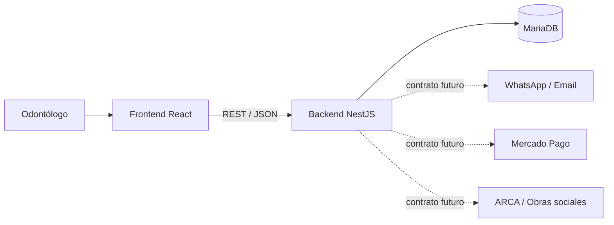

# Descripción General

## Tipo y escala del sistema

- **Tipo:** aplicación web con API REST.
- **Dominio:** gestión de agenda y turnos odontológicos.
- **Escala del MVP:** un único usuario operativo y un único odontólogo.
- **Persistencia:** base de datos relacional MariaDB.
- **Infraestructura propia:** sí; al menos backend, frontend y base de datos.

## Stack tecnológico

| Capa | Tecnología acordada | Versión |
|---|---|---|
| Backend | NestJS sobre Node.js | A definir al inicializar el proyecto; debe quedar fijada en el lockfile |
| Frontend | React | A definir al inicializar el proyecto; debe quedar fijada en el lockfile |
| Base de datos | MariaDB | A definir y documentar en la implementación |
| Contrato HTTP | REST + JSON | Versionado inicial interno `/api` o alternativa a confirmar |
| Pruebas | Herramientas compatibles con NestJS y React | Selección pendiente de la fundación técnica |

No se decidió todavía ORM, gestor de migraciones, librería de formularios, sistema de estilos ni mecanismo de sesión/token. La autenticación mínima sí quedó definida como email y contraseña para el único odontólogo.

## Arquitectura general

El frontend presenta catálogos y agenda. El backend concentra reglas de negocio y validaciones temporales; MariaDB asegura persistencia y restricciones. Las integraciones futuras se representan mediante puertos o interfaces, pero no se conectan a proveedores reales en el MVP.

## Módulos de dominio propuestos

| Módulo | Responsabilidad |
|---|---|
| Pacientes | Datos mínimos, unicidad condicional de DNI y advertencias de duplicado |
| Prestaciones | Nombre, duración predeterminada e intervalo opcional específico |
| Sillones | Catálogo de recursos físicos disponibles |
| Disponibilidad | Horarios semanales, excepciones fechadas y configuración global |
| Turnos | Creación, consulta, estados, reprogramación, cancelación y solapamientos |
| Auditoría | Historial de cambios y motivos obligatorios en operaciones excepcionales |
| Autenticación | Acceso del odontólogo mediante email y contraseña; sin registro público |

## API REST preliminar

La siguiente lista expresa recursos esperados, no un contrato definitivo de endpoints:

- `/api/pacientes`
- `/api/prestaciones`
- `/api/sillones`
- `/api/disponibilidad-semanal`
- `/api/excepciones-disponibilidad`
- `/api/configuracion-agenda`
- `/api/turnos`
- `/api/turnos/{id}/confirmar`
- `/api/turnos/{id}/reprogramar`
- `/api/turnos/{id}/cancelar`
- `/api/turnos/{id}/historial`

Los nombres, verbos HTTP, DTO y códigos de respuesta se definirán en los specs del change correspondiente.

## Integraciones externas

| Servicio | Propósito futuro | Estado en MVP | Límite recomendado |
|---|---|---|---|
| WhatsApp Business | Recordatorios y confirmaciones | No implementado | Interfaz de mensajería independiente del proveedor |
| Email | Recordatorios y confirmaciones | No implementado | Interfaz de mensajería compartida o adaptador específico |
| Mercado Pago | Señas y cobros | No implementado | Puerto de pagos, sin dependencia desde Turnos |
| ARCA | Facturación electrónica | No implementado | Módulo fiscal separado |
| Obras sociales | Coberturas y liquidaciones | No implementado | Módulo administrativo separado |

## Principios de diseño

1. Las reglas temporales viven en el backend y no dependen del reloj del navegador.
2. La base de datos complementa, pero no reemplaza, las validaciones de dominio.
3. Cancelar o reprogramar no destruye evidencia histórica.
4. El MVP no introduce entidades de profesional, sucursal, pago o historia clínica.
5. Los datos de ejemplo son ficticios y reconocibles como tales.
6. Toda decisión todavía abierta permanece documentada como tal.

