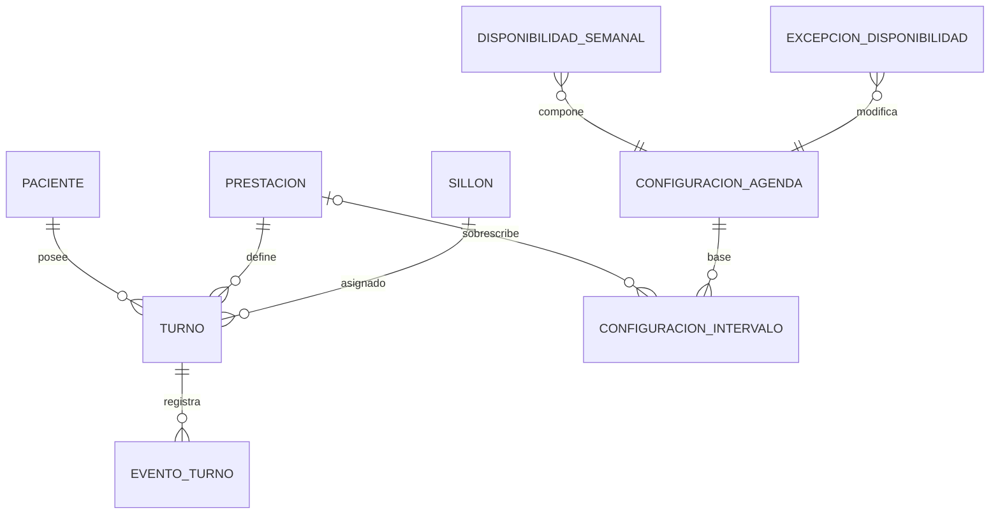

# Modelo de Datos

## Dominios

- **Pacientes:** identidad mínima y prevención de duplicados.
- **Catálogos:** prestaciones y sillones.
- **Disponibilidad:** configuración global, horarios semanales y excepciones por fecha.
- **Turnos:** reserva de tiempo, estados y operaciones sobre la agenda.
- **Auditoría:** historial de cambios, motivos y datos anteriores.
- **Acceso:** usuario odontólogo autenticado mediante email y contraseña.

## ERD propuesto

El diagrama representa el modelo conceptual. La forma exacta de `CONFIGURACION_INTERVALO` puede resolverse como columnas en `PRESTACION` y `CONFIGURACION_AGENDA`; no exige una tabla separada.

## Entidades

### Paciente

| Atributo | Tipo conceptual | Requerido | Observaciones |
|---|---|---:|---|
| id | UUID o identificador equivalente | Sí | Decisión técnica del change base |
| nombre | texto | Sí | Debe normalizar espacios; reglas de longitud pendientes |
| telefono | texto | Sí | No es único porque puede compartirse |
| dni | texto nullable | No | Único solamente cuando está informado |
| email | texto nullable | No | Validar formato cuando se informa |
| createdAt / updatedAt | fecha-hora | Sí | Auditoría técnica |
| deletedAt o activo | nullable / booleano | Pendiente | Depende de la política de baja lógica |

**Índices y constraints:**

- índice único filtrado o estrategia equivalente para `dni` no nulo;
- índice de búsqueda para nombre y teléfono;
- la coincidencia nombre + teléfono genera advertencia, no rechazo.

### Prestacion

| Atributo | Tipo conceptual | Requerido | Observaciones |
|---|---|---:|---|
| id | identificador | Sí | Clave primaria |
| nombre | texto | Sí | Unicidad o duplicados pendientes de decisión |
| duracionPredeterminadaMinutos | entero positivo | Sí | Máximo 240 minutos |
| intervaloPosteriorMinutos | entero nullable | No | Entre 0 y 30; si es nulo, se usa el intervalo global |
| activo / deletedAt | según política | Pendiente | No debe romper turnos históricos |

### Sillon

| Atributo | Tipo conceptual | Requerido | Observaciones |
|---|---|---:|---|
| id | identificador | Sí | Clave primaria |
| nombre | texto | Sí | Ejemplo ficticio: “Sillón 1” |
| activo / deletedAt | según política | Pendiente | Turnos históricos conservan referencia |

Aunque existan varios sillones, no puede haber turnos simultáneos porque hay un solo odontólogo.

### ConfiguracionAgenda

| Atributo | Tipo conceptual | Requerido | Observaciones |
|---|---|---:|---|
| id | identificador o singleton | Sí | Puede existir una única fila |
| intervaloGlobalMinutos | entero entre 0 y 30 | Sí | Valor inicial: 10 minutos |
| zonaHoraria | texto IANA | Sí | `America/Argentina/Buenos_Aires` |

### DisponibilidadSemanal

| Atributo | Tipo conceptual | Requerido | Observaciones |
|---|---|---:|---|
| id | identificador | Sí | Clave primaria |
| diaSemana | enum 1–7 o equivalente | Sí | Convención pendiente de fijar |
| horaInicio | hora local | Sí | Menor que horaFin |
| horaFin | hora local | Sí | Puede haber más de un tramo por día |

**Constraint:** los tramos semanales no deberían solaparse entre sí. La política para tramos contiguos debe fijarse en el spec correspondiente.

### ExcepcionDisponibilidad

| Atributo | Tipo conceptual | Requerido | Observaciones |
|---|---|---:|---|
| id | identificador | Sí | Clave primaria |
| fecha | fecha local | Sí | Afecta una fecha concreta |
| tipo | enum | Sí | FERIADO, VACACIONES o BLOQUEO; habilitaciones extraordinarias son una decisión pendiente |
| horaInicio / horaFin | hora nullable | Según tipo | Permite bloqueo total o parcial |
| motivo | texto | Sí | Explica la excepción |

### Turno

| Atributo | Tipo conceptual | Requerido | Observaciones |
|---|---|---:|---|
| id | identificador | Sí | Clave primaria |
| pacienteId | referencia | Sí | Paciente existente |
| prestacionId | referencia | Sí | Prestación existente |
| sillonId | referencia | Sí | Sillón existente |
| inicio | fecha-hora | Sí | Interpretado en la zona horaria acordada |
| duracionMinutos | entero entre 1 y 240 | Sí | Copia efectiva; puede sobrescribirse al crear |
| intervaloPosteriorMinutos | entero entre 0 y 30 | Sí | Copia efectiva; puede sobrescribirse al crear |
| finAtencion | fecha-hora derivada | Sí | `inicio + duracionMinutos` |
| finBloqueo | fecha-hora derivada | Sí | `finAtencion + intervaloPosteriorMinutos` |
| estado | enum | Sí | PROGRAMADO, CONFIRMADO, ATENDIDO, CANCELADO, AUSENTE |
| fueraDisponibilidad | booleano | Sí | Verdadero solo con excepción manual |
| motivoExcepcion | texto nullable | Condicional | Obligatorio si `fueraDisponibilidad = true` |
| motivoCancelacion | texto nullable | Condicional | Obligatorio al cancelar |
| createdAt / updatedAt | fecha-hora | Sí | Auditoría técnica |

Guardar duración e intervalo efectivos en el turno evita que un cambio posterior de la prestación reescriba implícitamente la agenda histórica.

### EventoTurno

| Atributo | Tipo conceptual | Requerido | Observaciones |
|---|---|---:|---|
| id | identificador | Sí | Clave primaria |
| turnoId | referencia | Sí | Turno asociado |
| tipo | enum | Sí | CREADO, REPROGRAMADO, CANCELADO, CAMBIO_ESTADO, EXCEPCION |
| ocurridoEn | fecha-hora | Sí | Momento del evento |
| estadoAnterior / estadoNuevo | enum nullable | Según evento | Trazabilidad de estado |
| inicioAnterior / inicioNuevo | fecha-hora nullable | Según evento | Reprogramación |
| sillonAnteriorId / sillonNuevoId | referencia nullable | Según evento | Reprogramación |
| motivo | texto nullable | Condicional | Obligatorio en cancelación y excepción |

## Restricciones temporales

- Para cada turno bloqueante, el intervalo ocupado es `[inicio, finBloqueo)`.
- Dos intervalos no se solapan si uno termina exactamente cuando comienza el otro.
- La consulta de conflictos debe contemplar todos los sillones para el odontólogo y, además, el sillón elegido.
- PROGRAMADO, CONFIRMADO, ATENDIDO y AUSENTE son estados bloqueantes; CANCELADO libera el horario.
- La validación y el guardado deben ser atómicos para evitar conflictos por concurrencia.
- Los horarios se interpretan en `America/Argentina/Buenos_Aires` (UTC−03:00) y los instantes se almacenan normalizados en UTC.

## Seed data inicial

Solo se permiten datos ficticios:

- configuración global con intervalo de 10 minutos;
- uno o más sillones con nombres genéricos;
- prestaciones ficticias con duraciones definidas por el equipo;
- disponibilidad semanal ficticia;
- pacientes de prueba claramente ficticios.

No se deben incluir DNI, teléfonos, emails ni nombres de personas reales.

