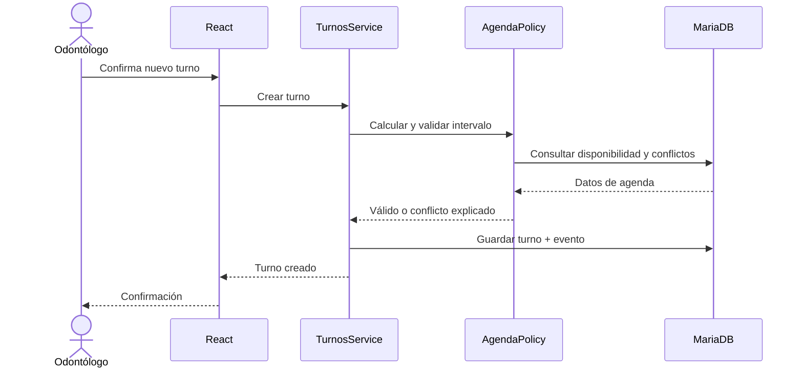
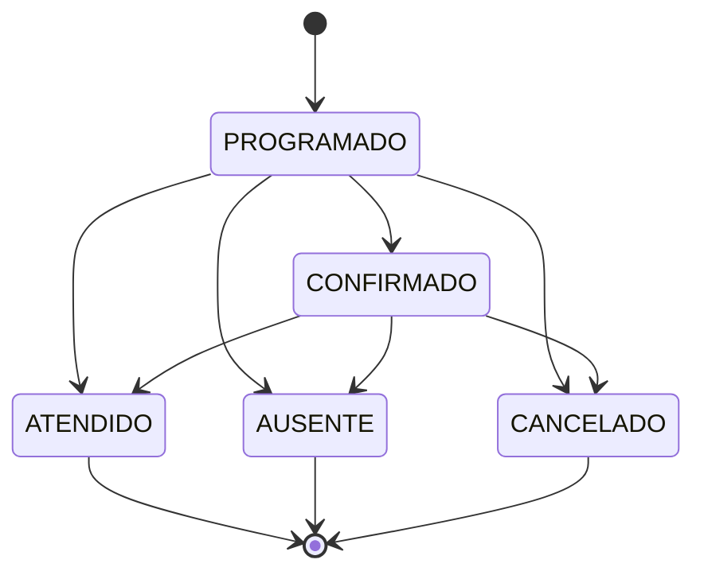

# Flujos Principales

## Flujo 1: registrar paciente

**Disparador:** el odontólogo necesita asociar un paciente a la agenda.  
**Actor:** odontólogo.

```mermaid
sequenceDiagram
    actor O as Odontólogo
    participant F as React
    participant B as NestJS
    participant D as MariaDB
    O->>F: Completa nombre, teléfono y opcionales
    F->>B: Solicita alta
    B->>D: Comprueba DNI y coincidencias
    D-->>B: Resultado
    B-->>F: Alta o error; advertencia si corresponde
    F-->>O: Muestra resultado
```

**Casos de error:**

- faltan nombre o teléfono → rechazo de validación;
- DNI existente → error de negocio;
- email inválido → rechazo de validación;
- nombre y teléfono coincidentes → advertencia que permite decidir continuar.

## Flujo 2: crear turno ordinario

**Disparador:** el odontólogo selecciona un horario para un paciente.  
**Actor:** odontólogo.

**Pasos:**

1. El frontend solicita pacientes, prestaciones, sillones y configuración necesaria.
2. El odontólogo selecciona paciente, prestación, sillón, fecha y hora.
3. Puede sobrescribir la duración predeterminada.
4. El backend calcula duración e intervalo efectivos.
5. Construye el intervalo `[inicio, finBloqueo)`.
6. Comprueba disponibilidad semanal y excepciones fechadas.
7. Comprueba conflictos contra todos los turnos bloqueantes del odontólogo.
8. Comprueba conflictos del sillón elegido.
9. Persiste turno y evento de creación en una operación consistente.
10. Devuelve el turno con sus tiempos efectivos.



**Casos de error:**

- fuera de disponibilidad → ofrecer flujo excepcional, no guardar automáticamente;
- conflicto con odontólogo o sillón → rechazar e indicar motivo;
- paciente, prestación o sillón inexistente/inactivo → rechazar;
- conflicto concurrente al guardar → abortar y solicitar nueva selección.

## Flujo 3: crear turno fuera de disponibilidad

**Disparador:** la validación informa que el horario está fuera de disponibilidad.  
**Actor:** odontólogo.

**Pasos:**

1. El sistema explica que el horario no está disponible.
2. El odontólogo elige continuar como excepción.
3. El frontend exige un motivo.
4. El backend vuelve a verificar solapamientos; estos no pueden exceptuarse.
5. Si no hay conflictos, guarda el turno con `fueraDisponibilidad = true`.
6. Registra un evento de excepción con el motivo.

**Casos de error:**

- motivo vacío → rechazo;
- solapamiento → rechazo sin posibilidad de override;
- agenda cambió concurrentemente → rechazo y actualización de vista.

## Flujo 4: reprogramar turno

**Disparador:** el odontólogo solicita mover un turno existente.  
**Actor:** odontólogo.

**Pasos:**

1. El sistema carga el turno y su versión actual.
2. El odontólogo selecciona nueva fecha/hora y, opcionalmente, otro sillón; conserva duración e intervalo efectivos.
3. El backend valida la propuesta con las mismas reglas de creación, excluyendo el propio turno de la búsqueda de conflictos.
4. Si es válida, actualiza el turno.
5. Registra un evento con inicio y sillón anteriores/nuevos.
6. Si falla, conserva intacto el turno original.

**Casos de error:** turno cancelado o transición no admitida; conflicto; fuera de disponibilidad sin excepción; edición concurrente.

## Flujo 5: cancelar turno

**Disparador:** el odontólogo decide cancelar.  
**Actor:** odontólogo.

**Pasos:**

1. El sistema solicita motivo.
2. El backend valida la transición.
3. Cambia el estado a CANCELADO sin eliminar el registro.
4. Registra estado anterior, nuevo estado, motivo y momento.
5. La agenda recalcula disponibilidad según la política de estados bloqueantes aprobada.

**Casos de error:** motivo vacío; turno inexistente; transición no válida; modificación concurrente.

## Flujo 6: consultar agenda

**Disparador:** el odontólogo abre una fecha o rango.  
**Actor:** odontólogo.

**Pasos:**

1. El frontend solicita el rango y filtros de sillón/estado.
2. El backend devuelve turnos ordenados, disponibilidad y excepciones relevantes.
3. El frontend diferencia atención, intervalo, bloqueo y excepción.
4. El odontólogo puede abrir el detalle y el historial de un turno.

**Casos de error:** rango inválido; rango excesivo; datos cambiados durante la consulta. La interfaz debe permitir refrescar sin inventar disponibilidad localmente.

## Flujo 7: cambio de estado e historial

**Disparador:** el odontólogo confirma, atiende o marca ausencia.  
**Actor:** odontólogo.

1. El frontend envía la transición solicitada.
2. El backend comprueba la matriz de transiciones vigente.
3. Actualiza el estado y registra un evento.
4. Devuelve el turno actualizado y el historial ordenado.



PROGRAMADO, CONFIRMADO, ATENDIDO y AUSENTE bloquean el horario; CANCELADO lo libera. ATENDIDO y AUSENTE solo pueden registrarse cuando comenzó el turno. Solo PROGRAMADO y CONFIRMADO pueden reprogramarse; si un turno CONFIRMADO se reprograma, vuelve a PROGRAMADO para confirmar el nuevo horario.

