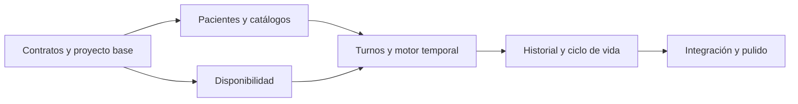

# Arquitectura Propuesta

## Objetivos arquitectónicos

- Mantener las reglas temporales separadas de la interfaz.
- Hacer comprobables los casos de borde sin depender del reloj real.
- Evitar que tres changes paralelos modifiquen los mismos contratos.
- Permitir integraciones futuras sin introducirlas en el MVP.
- Conservar historial y consistencia frente a operaciones concurrentes.

## Patrones aplicados

| Patrón | Dónde se usa | Por qué |
|---|---|---|
| Módulos por dominio | Backend NestJS | Aísla pacientes, catálogos, disponibilidad y turnos |
| Capa de aplicación | Casos de uso del backend | Coordina persistencia, validaciones e historial |
| Política de dominio | Cálculo de intervalos y conflictos | Permite tests unitarios puros y reglas explícitas |
| Repositorio | Acceso a MariaDB | Desacopla reglas del ORM elegido |
| Adaptadores | Mensajería, pagos y fiscalidad futuras | Evita acoplamiento a proveedores fuera del MVP |
| Features | Frontend React | Agrupa páginas, componentes y API por capacidad |
| DTO + validación | Frontera HTTP | Rechaza entradas inválidas antes de ejecutar casos de uso |

## Estructura de directorios propuesta

```text
proyecto/
├── backend/
│   ├── src/
│   │   ├── modules/
│   │   │   ├── patients/
│   │   │   ├── services/
│   │   │   ├── chairs/
│   │   │   ├── availability/
│   │   │   ├── appointments/
│   │   │   └── audit/
│   │   ├── shared/
│   │   └── main.ts
│   └── test/
├── frontend/
│   └── src/
│       ├── features/
│       │   ├── patients/
│       │   ├── catalog/
│       │   ├── availability/
│       │   └── appointments/
│       ├── pages/
│       └── shared/
├── knowledge-base/
├── docs/
├── openspec/
└── tests/                  # Solo si se adopta una capa E2E común
```

La estructura es una propuesta para el roadmap. No obliga a crear un monorepo con una herramienta específica ni decide nombres técnicos internos antes del primer change.

## Diseño del motor temporal

Se recomienda una política pura que reciba:

- inicio propuesto;
- duración efectiva;
- intervalo efectivo;
- disponibilidad aplicable;
- excepciones de fecha;
- turnos potencialmente conflictivos;
- sillón seleccionado;
- estados considerados bloqueantes.

Y devuelva un resultado explícito:

- válido;
- fuera de disponibilidad y susceptible de override;
- conflicto con el odontólogo;
- conflicto con el sillón;
- datos inválidos.

La política no persiste ni usa la hora del sistema directamente. El caso de uso controla transacción, concurrencia e historial.

## Consistencia y concurrencia

Una consulta previa desde el frontend no garantiza disponibilidad. El backend debe repetir la validación dentro de la operación de escritura.

La estrategia exacta —transacción con nivel de aislamiento, bloqueo, versión optimista u otra— depende del ORM y deberá justificarse en el design del change. Como mínimo, dos solicitudes concurrentes incompatibles no pueden finalizar ambas con éxito.

## Seguridad

- **Autenticación:** email y contraseña para el único odontólogo; mecanismo de sesión/token y bootstrap pendientes.
- **Autorización:** rol único `ODONTOLOGO` en el MVP.
- **Validación:** DTO de entrada y reglas de dominio; nunca confiar en el frontend.
- **Credenciales:** variables de entorno, nunca versionadas.
- **Datos personales:** minimizar exposición; no registrar payloads completos en logs.
- **Datos académicos:** usar información ficticia en seeds, fixtures, capturas y demos.
- **Auditoría:** conservar eventos funcionales de turnos, separados de logs técnicos.
- **Healthcheck:** sin información sensible.

## Estrategia de pruebas

### Unitarias

- cálculo de duración e intervalo;
- intervalos contiguos y solapados;
- precedencia de intervalo global/prestación/turno;
- validación de disponibilidad y excepciones;
- transiciones y motivos.

### Integración

- persistencia de turnos e historial;
- DNI único cuando está informado;
- conflictos concurrentes;
- rollback si falla el historial o la actualización.

### API / E2E

- escenario feliz por historia prioritaria;
- error de negocio;
- borde temporal, especialmente inicio exacto al finalizar el bloqueo anterior.

Los tests deben controlar fecha y hora mediante datos fijos o un reloj inyectable; no deben depender de “ahora”.

## Variables de entorno previstas

| Variable | Descripción | Ejemplo ficticio | Sensible |
|---|---|---|---:|
| `APP_ENV` | Entorno de ejecución | `development` | No |
| `BACKEND_PORT` | Puerto HTTP | `3000` | No |
| `DATABASE_HOST` | Host de MariaDB | `localhost` | No |
| `DATABASE_PORT` | Puerto de MariaDB | `3306` | No |
| `DATABASE_NAME` | Base de datos | `turnos_odontologia` | No |
| `DATABASE_USER` | Usuario de base | `app_user` | Sí |
| `DATABASE_PASSWORD` | Contraseña | Nunca incluir valor real | Sí |
| `APP_TIME_ZONE` | Zona horaria operativa | `America/Argentina/Buenos_Aires` | No |
| `AUTH_SECRET` | Secreto si se adopta token firmado | Nunca incluir valor real | Sí |

`AUTH_SECRET` solo aplica si el design técnico elige tokens firmados; email y contraseña no obligan por sí mismos a usar JWT.

## Observabilidad mínima

- logs estructurados sin datos personales completos;
- identificador de solicitud para errores;
- errores de dominio distinguibles de errores técnicos;
- healthcheck de aplicación y base;
- sin servicios externos de telemetría obligatorios en el MVP.

## Dependencias de implementación



El roadmap puede refinar el paralelismo, pero no debe comenzar cambios que dependan del motor temporal antes de fijar sus contratos y preguntas P0.

