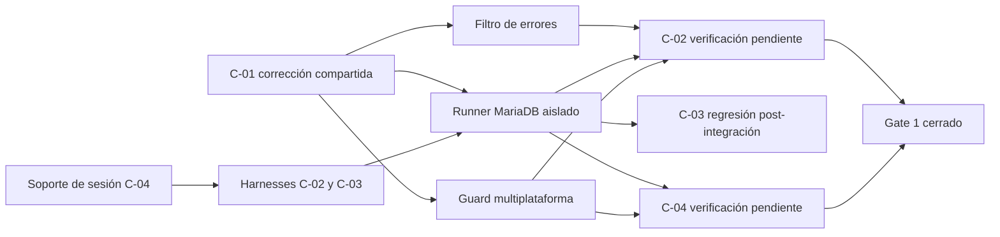

# Design

## Context

Ver [proposal.md](proposal.md) para la motivación. Los contratos canónicos ya exigen códigos HTTP estables, pruebas sobre MariaDB real y equivalencia entre el guard local y GitHub Actions; este seguimiento corrige su implementación sin alterar esos requisitos.

El backend usa Jest con módulos ESM y TypeORM descubre entidades y migraciones mediante imports dinámicos. La evidencia registrada por C-02 muestra que ejecutar varias suites de integración en el mismo proceso deja módulos asociados al entorno Jest anterior. Además, la suite histórica de C-01 llama `undoLastMigration()` aunque C-01 ya no es la última migración del repositorio.

La primera ejecución del runner aislado confirmó Auth 12/12, pero reveló 16 respuestas HTTP 401 en Availability: C-02 y C-03 fueron escritos antes de que C-04 instalara el guard global y sus harnesses no adjuntan sesión a endpoints ahora protegidos. Después de autenticar los harnesses, Patients pasó 17/18 y expuso otro supuesto histórico: `undoLastMigration()` revierte C-04, no C-02.

## Goals / Non-Goals

**Goals:**

- Propagar únicamente códigos de dominio con formato controlado y detalles compatibles con `ApiErrorDetails`.
- Ejecutar todas las suites de integración descubiertas, una por proceso Jest y en orden determinista.
- Mantener la base de integración en un estado migrado sin revertir por accidente una migración ajena.
- Ejecutar las suites funcionales contra el guard real usando una cuenta y sesión totalmente ficticias.
- Ejecutar realmente el guard cuando `check.mjs` se invoca como archivo tanto en Windows como en Linux.
- Producir pruebas automáticas específicas para cada regresión.

**Non-Goals:**

- Reemplazar los globs de TypeORM por un registro central de entidades y migraciones.
- Cambiar la forma de autenticación, las reglas de pacientes/catálogos o los contratos REST.
- Hacer públicas rutas protegidas, reemplazar el guard o ignorar suites que devuelven 401.
- Corregir advertencias y observaciones menores no bloqueantes de la fundación.
- Hacer verificación visual o modificar UI.

## Decisions

### 1. Códigos de dominio explícitos con fallback cerrado

`ApiExceptionFilter` reconocerá `code` solo cuando sea un string que cumpla `^[A-Z][A-Z0-9_]*$`. Conservará `details` únicamente si es un objeto no nulo o un arreglo compuesto enteramente por strings. Si el payload no cumple esas condiciones, se mantiene el comportamiento existente: `VALIDATION_ERROR` para validaciones y `HTTP_<status>` para las demás excepciones.

Esto evita convertir cualquier propiedad arbitraria en parte del contrato público. La alternativa de propagar todos los campos de `HttpException` se descarta porque ampliaría la superficie de datos expuestos y debilitaría el filtrado seguro.

### 2. Un proceso Jest por suite, en serie

Un runner ESM sin dependencias adicionales descubrirá archivos `*.integration-spec.ts` debajo de `test/` y `src/`, los ordenará de forma estable y lanzará un proceso Node/Jest por archivo con `--runTestsByPath`. Heredará entorno y salida, se detendrá con código no cero ante la primera suite fallida y fallará explícitamente si no descubre suites.

El aislamiento por proceso conserva los globs actuales de TypeORM y elimina la contaminación de entornos Jest. La alternativa de imports estáticos se descarta porque obligaría a cada change a editar un registro compartido; ejecutar suites en paralelo se descarta porque todas usan la misma base MariaDB.

La configuración Jest también declarará ambos patrones de descubrimiento para que la selección directa y las herramientas auxiliares reconozcan las suites modulares.

### 3. Las pruebas históricas no revierten la última migración global

`database.integration-spec.ts` ejecutará migraciones pendientes y verificará el artefacto de C-01, pero no llamará `undoLastMigration()` sobre una base compartida. La prueba histórica de Patients aplicará el mismo criterio para C-02: comprobará que `C02CreatePatientsAndCatalogs2026112400000` figura en `app_migrations`, que existen `patients`, `procedures` y `chairs`, y que C-04 permanece aplicada.

Probar el `down` de una migración concreta en el esquema acumulado requeriría una base aislada en el estado exacto de ese change o desmontar y reaplicar todas las migraciones posteriores. Ninguna opción es necesaria para validar el runtime integrado actual; el `down` ya fue verificado en la rama C-02 antes del merge.

La alternativa de conservar `undoLastMigration()` se descarta porque, después de C-02/C-03/C-04, revierte C-04 y produce una aserción engañosa sobre C-02.

### 4. Detección de entrypoint mediante rutas normalizadas por Node

El guard comparará `pathToFileURL(path.resolve(process.argv[1])).href` con `import.meta.url`. La prueba ejecutará el archivo como subproceso con un branch inexistente y comprobará código no cero y diagnóstico; así se valida la entrada real, no solo la función exportada.

Se descarta construir manualmente una URL `file:///` porque duplica reglas de rutas y falla con paths POSIX absolutos.

### 5. Sesión ficticia compartida para suites funcionales

Los contextos de integración de C-02 y C-03 crearán o reutilizarán la cuenta ficticia mediante `authenticatedCookie(dataSource)` de C-04 y devolverán `sessionCookie` junto con `app` y `dataSource`. Los helpers `http()` de Catálogos, Pacientes y Availability adjuntarán esa cookie a cada request protegida.

Este enfoque prueba la composición real de los módulos y conserva el guard activo. La alternativa de marcar las rutas como públicas o sobrescribir `APP_GUARD` se descarta porque produciría una integración distinta de producción. La alternativa de hacer login HTTP en cada test se descarta por costo y duplicación; la suite Auth ya cubre login/cookies y el soporte compartido genera el mismo token firmado con datos ficticios.

Cada suite corre en su propio proceso, por lo que la cuenta idempotente y su cookie no se comparten entre entornos Jest. Las limpiezas de C-02/C-03 no eliminan `users`.

### 6. Orden de integración

## UI Mockups

- Decision: no (no UI)
- Motivo: el change modifica infraestructura de backend, pruebas y tooling; no altera pantallas ni estilos.

## Risks / Trade-offs

- **[Mayor duración de integración]** Cada suite arranca Jest y Nest por separado → aceptar el costo a cambio de aislamiento y ejecución determinista; informar cada archivo mientras corre.
- **[Detalles de dominio con datos indebidos]** El filtro valida estructura, no semántica → mantener tests sin datos personales y exigir que los productores usen detalles mínimos tipados.
- **[Estado residual de MariaDB]** Las suites comparten una base aunque no un proceso → conservar ejecución serial y responsabilizar a cada harness de limpiar sus fixtures ficticios.
- **[Autenticación encubre errores funcionales]** Una cookie mal construida convertiría todas las expectativas en 401 → aprovisionar mediante el soporte real de C-04 y mantener Auth como primera suite verde independiente.
- **[Diferencias de rutas entre plataformas]** Windows y Linux representan rutas distintas → usar `path.resolve` y `pathToFileURL`, APIs nativas de Node, y probar la invocación directa.

## Migration Plan

1. Aplicar y probar filtro y guard con suites unitarias locales.
2. Incorporar el runner y ajustar las pruebas históricas C-01/C-02 a verificaciones acumulativas no destructivas.
3. Adaptar los contextos de C-02/C-03 para crear una sesión ficticia y adjuntarla en sus helpers HTTP.
4. Ejecutar build, unitarias y guard en Windows.
5. Ejecutar `npm run test:integration` contra la MariaDB real configurada y registrar versión/resultado.
6. Integrar la rama C-01 en `main`; C-02 y C-04 actualizarán sus verificaciones desde ese commit.

Rollback: revertir el commit correctivo completo. No hay migraciones de esquema ni datos que restaurar.
